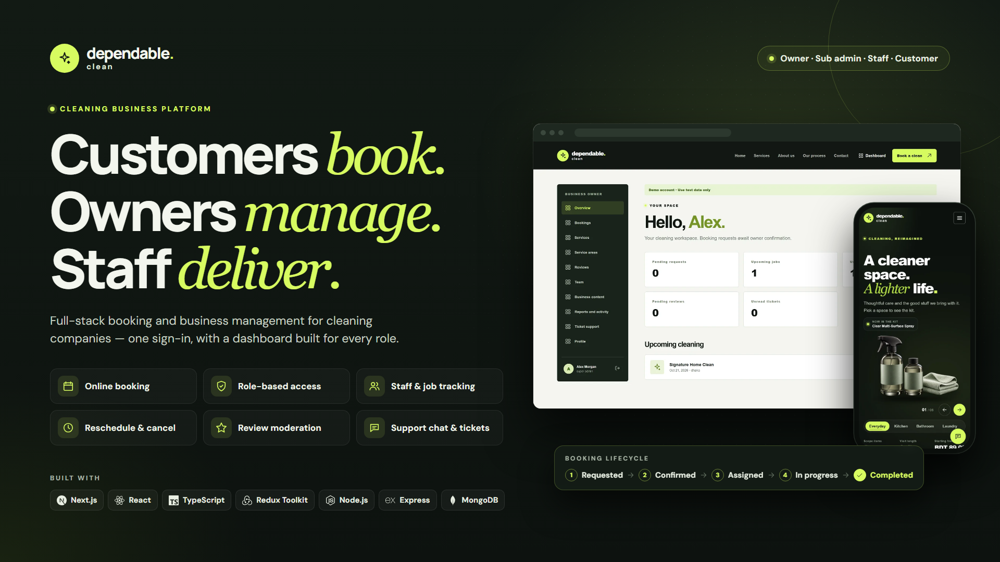

# Dependable Clean



**Live website:** [dependable-clean-client.vercel.app](https://dependable-clean-client.vercel.app/)

Dependable Clean is a website for a cleaning business. Customers book a cleaning, the owner manages the business, and staff go out and do the jobs. Everyone signs in and lands on the same dashboard, but each person only sees what their role allows.

## Who does what

### Owner (super admin)
The person who runs the business. They can do everything:
- Set up services, prices and the areas the business covers.
- Write the public contact details, FAQ, cancellation policy and offers.
- Add staff and sub admins, change their names, and switch their access off or back on.
- See every booking, confirm it, and send a staff member to do the job.
- Approve or turn down reschedule and cancellation requests.
- Approve, reject or hide customer reviews.
- Chat privately with customers and hand support tickets to staff.
- See reports and a log of what has changed.

### Sub admin
A manager who helps the owner. They can do everything the owner can, **except** add or change team members.

### Staff
The cleaners who do the work. They can:
- See the jobs given to them and their schedule.
- Mark a job as started, then as finished.
- Leave internal notes on a job (customers never see these).
- Answer the support tickets handed to them.
- Update their own profile.

Staff can't see other people's jobs, reports, reviews or team settings. If the owner switches a staff member off, they lose access straight away.

### Customer
The people who book cleanings. They can:
- Request a cleaning (at least 3 days ahead, in an area the business covers).
- See their bookings and past history.
- Ask to reschedule or cancel a booking.
- Leave one review after a job is finished (it shows publicly once the owner approves it).
- Chat privately with the business for support.
- Update their own profile.

## How a booking moves

1. **Requested** – the customer asks for a cleaning.
2. **Confirmed** – the owner accepts it.
3. **Assigned** – the owner picks a staff member.
4. **In progress** – the staff member starts the job.
5. **Completed** – the job is done and the customer can leave a review.

A booking can be cancelled any time before the work starts.

## Run it on your computer

```bash
npm install
npm run dev
```

- Website: http://localhost:3000
- API: http://localhost:5000

Without a database, the app runs with temporary test data that is wiped on restart. Demo **Admin**, **Staff** and **Customer** sign-in buttons appear in local development so you can try each role (set `DEMO_ACCOUNTS=off` to hide them).

To keep data, copy `backend/.env.example` to `backend/.env` and fill in `MONGODB_URI`, `DB_NAME`, `CLIENT_ORIGIN` and a strong `AUTH_SECRET`.

## First-time owner setup

1. Put `OWNER_EMAIL` and `OWNER_NAME` in the backend `.env`.
2. Run `npm run setup-owner --workspace @dependable-clean/server`.
3. Open the link it prints (valid for 24 hours) and choose a password.
4. From the dashboard, add service areas, services and prices, your business contact info, and your team.

The business timezone and currency default to `Asia/Dhaka` and `BDT` (change with `BUSINESS_TIMEZONE` and `BUSINESS_CURRENCY`). Don't change the currency after real bookings exist, because old prices are not converted.

## Checks

- `npm test` – runs the automated tests (they never touch real data or contact real people).
- `npm run build` – builds the website and checks for type errors.
