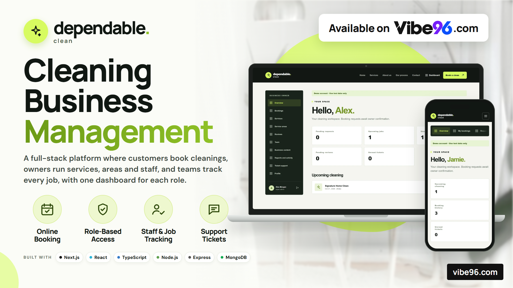

# Dependable Clean



**Live website:** [dependable-clean-client.vercel.app](https://dependable-clean-client.vercel.app/) · **Live API:** [dependable-clean-client.onrender.com/health](https://dependable-clean-client.onrender.com/health)

The live site is a public demo with no real customer data. On the sign-in page, the **Admin**, **Staff** and **Customer** demo buttons open each role (the free API host may take up to a minute to wake). `npm run check:live` signs in as each demo role against the live API and loads its dashboard.

Dependable Clean is a website for a cleaning business. Customers book a cleaning, the owner manages the business, and staff go out and do the jobs. Everyone signs in and lands on the same dashboard, but each person only sees what their role allows.

## Who does what

### Owner (super admin)
The person who runs the business. They can do everything:
- Set up services, prices and the areas the business covers.
- Write the public contact details, FAQ, cancellation policy and offers.
- Add staff and sub admins, change their names, and switch their access off or back on.
- See every booking, confirm it, and send a staff member to do the job.
- Approve or turn down reschedule and cancellation requests.
- Approve, reject or hide customer reviews.
- Chat privately with customers and hand support tickets to staff.
- See reports and a log of what has changed.

### Sub admin
A manager who helps the owner. They can do everything the owner can, **except** add or change team members.

### Staff
The cleaners who do the work. They can:
- See the jobs given to them and their schedule.
- Mark a job as started, then as finished.
- Leave internal notes on a job (customers never see these).
- Answer the support tickets handed to them.
- Update their own profile.

Staff can't see other people's jobs, reports, reviews or team settings. If the owner switches a staff member off, they lose access straight away.

### Customer
The people who book cleanings. They can:
- Request a cleaning (at least 3 days ahead, in an area the business covers).
- See their bookings and past history.
- Ask to reschedule or cancel a booking.
- Leave one review after a job is finished (it shows publicly once the owner approves it).
- Chat privately with the business for support.
- Update their own profile.

## How a booking moves

1. **Requested** – the customer asks for a cleaning.
2. **Confirmed** – the owner accepts it.
3. **Assigned** – the owner picks a staff member.
4. **In progress** – the staff member starts the job.
5. **Completed** – the job is done and the customer can leave a review.

A booking can be cancelled any time before the work starts.

## Run it on your computer

Needs Node.js 20.13+ (see `.nvmrc`). Full steps are in [HowToSetup.md](HowToSetup.md).

**Quick look, no database:**

```bash
npm ci
npm run dev
```

- Website: http://localhost:3000
- API: http://localhost:5000

Without `MONGODB_URI`, the API runs on temporary sample data that is wiped on restart. Demo **Admin**, **Staff** and **Customer** sign-in buttons appear in local development so you can try each role (set `DEMO_ACCOUNTS=off` to hide them).

**With MongoDB (keeps data):**

```bash
npm ci
cp backend/.env.example backend/.env          # set MONGODB_URI, DB_NAME, CLIENT_ORIGIN and AUTH_SECRET
cp frontend/.env.example frontend/.env.local  # NEXT_PUBLIC_API_URL, default http://localhost:5000
npm run db:setup                              # runs the migrations and adds the demo data
npm run dev
```

## First-time owner setup

1. Put `OWNER_EMAIL` and `OWNER_NAME` in the backend `.env`.
2. Run `npm run setup-owner`.
3. Open the link it prints (valid for 24 hours) and choose a password.
4. From the dashboard, add service areas, services and prices, your business contact info, and your team.

The business timezone and currency default to `Asia/Dhaka` and `BDT` (change with `BUSINESS_TIMEZONE` and `BUSINESS_CURRENCY`). Don't change the currency after real bookings exist, because old prices are not converted.

## Security

- Every create, update and delete route has a role guard; [docs/ROUTES.md](docs/ROUTES.md) lists every route with its guard and is checked by the tests.
- Lookups by id are scoped to the owner, the assigned staff member or an admin inside the database query.
- Passwords are scrypt hashes; tokens are HMAC-signed and can be revoked. Production refuses to start without a strong `AUTH_SECRET`.
- Sign-in endpoints are rate limited, request bodies are capped at 100 KB, and MongoDB operator keys (`$ne`, `$gt`, ...) are rejected.
- Demo accounts have no fixed password and are off in production unless `DEMO_ACCOUNTS=on`.

## Checks

- `npm test` – API, security and UI tests (they never touch real data or contact real people).
- `npm run build` – builds the website with type checks and syntax-checks the API.
- `npm audit --omit=dev` – 0 known vulnerabilities at the time of the last release (see [CHANGELOG.md](CHANGELOG.md)).
- `npm run check:live` – end-to-end check of the deployed demo.
